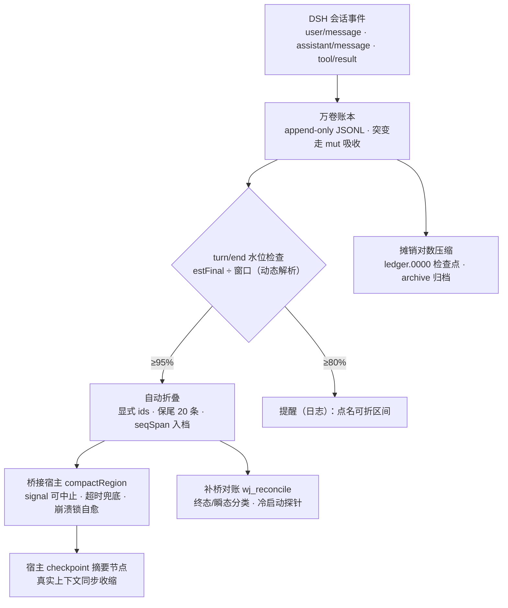

# 万卷 (wanjuan)

> 读书破万卷。上下文像卷轴一样一折一折收起来，需要时再展开。

[](https://github.com/05shizuku/wanjuan/releases) [](https://github.com/05shizuku/wanjuan/actions) [](https://nodejs.org) [](#-license)

**万卷** 是一个为 LLM 宿主（如 DeepSeek Harness）设计的**上下文压缩内核**。纯原生 Node.js ESM（>= 20），零第三方依赖，以事件溯源（Event Sourcing）与「前缀纪律」为根基，解决长对话场景下的窗口爆炸与 KV 缓存失效问题。

**万卷是一套自运转系统**：折叠自动、桥接自动、补桥自动、校准自动、学习自动、恢复自动、突变吸收自动、崩溃自愈自动——你正常聊天，它自己工作。



## 💡 核心理念：每个 Bug 都有归宿

在长上下文场景中，最大的噩梦不是「截断」，而是「缓存全灭」。万卷直面宿主环境的泥泞：

- **拒绝背锅（责任隔离）**：请求遥测带 `missKind` 归因框架（`overrideMissKind` 注入口已预留）；当前版本如实产出 `new / unattributed`，完整归因 M5 交付，不虚报命中率。
- **自我愈合（锚点吸收）**：宿主偷偷改了历史？万卷不在历史中重写，而是追加 `mut` 事件吸收突变，让账本真正收敛，告别死循环。
- **绝对容错（断电保护）**：写到一半断电导致账本坏行？跳过坏行并大声告警；下次追加前自动隔离崩溃半行（补换行符），新事件绝不陪葬。状态文件（桥接状态/自学习窗口）原子写，多进程下不读半截。
- **多会话隔离**：每个会话独立账本目录，A/B 窗口的折叠互不干涉；进程内单线程串行追加，跨进程依赖 profile 隔离。

## 🏗 里程碑（M1 → M4.4）

| 阶段 | 内容 |
|---|---|
| **M1–M3 观测与折叠** | 全词汇入账 + 四工具 + 两段式水位引擎（80% 点名区间提醒 / 95% 自动折叠保尾 20 条，UUID 主机走显式 ids） |
| **M3.5–M3.9 真实接管** | 桥接宿主 `compactRegion`（五层真机契约）+ 动态窗口与自学习 + 校准入档 + 自动补桥（终态/瞬态分类）+ 日志落盘审计 |
| **M4 自愈** | 重启恢复 · `mut` 突变吸收 · 摊销对数压缩（启动重放有界）· 突变嗅探（TTL）· 崩溃遗留锁自愈（冷启动主动探针 + busy 反应式双通道）· `signal` 信号中止 |

### M3 的两个关键修正

- **`estimator.estRaw` 不是方法**：它是 `estimate()` 返回值的字段。水位 = `estFinal`（k̂ 校准 + 5% 偏置）÷ 窗口。k̂ 用真实 usage 做按模型 EMA 校准（5 个样本后收敛），入档可观测。
- **宿主消息 ID 是 UUID**：字典序 ≠ 时间序（实测不单调）。折叠一律走**显式 ids 列表**，绝不传 range 端点——`ledger.recordFold`、`compressor.compress`、`wj_compress` 工具三处齐备。

### M3.5 为什么桥接宿主 compaction，而不是自己改请求

宿主三条瀑布全查证过：

- `agent/pre-step`：只给本轮新进的 `UserMessage[]`，历史不在场；
- `agent/request`：契约明文 **"cannot mutate messages"**，`LlmCallConfig` 只有控制项；
- `llm/stream`：LOOP 请求的 `messages` **深度冻结**（reconstructability 原则：请求必须是会话日志的纯函数）。

唯一合法入口是 `ctx.compaction.compactRegion(startSeq, endSeq, agent)`——成功后真实日志区间替换成一个摘要节点，模型可见、缓存责任归宿主。万卷在账本里记录事件 `seq`（SessionSeq），完成「账本消息 → 真实日志区间」的映射；服务缺失时优雅降级为只折账本。

### 真机契约五层（每层都是实测踩出来的）

| 层 | 坑 | 解法 |
|---|---|---|
| ① 访问控制 | 直接 `ctx.compaction` 抛 `cannot get property without inject` | `inject` 声明 `compaction`（及 `llm`） |
| ② agent 形态 | 裸传 Session 抛 `reading 'surface'` | 包装 `{ session, options }`（宿主内部走 `agent.session.surface`） |
| ③ whole-surface 稳定性 | 摘要期间表面变化即弃 | 手动路径 **await 宿主摘要完成**再返回工具结果 |
| ④ 净收益检查 | 宿主拒绝越压越大（checkpoint 摘要 ~1.2K token 起步） | 跨度需远大于摘要成本，小跨度转终态跳过 |
| ⑤ 边界配平 | 起点拆散 tool-call/result 对、终点 step 未闭合 | 起点自动回退到最近 user 消息；软失败入补桥队列 |

宿主压缩失败为**软失败**：告警入日志，账本折叠照常生效，欠账由补桥体系清理。

## 🧰 工具面

| 工具 | 作用 |
|---|---|
| `wj_compress` | 折叠指定消息为摘要（`ids` 显式集合优先，`range` 二选一；内置 KEEP/DROP 哲学） |
| `wj_reconcile` | 补桥：对宿主压缩未打通的历史块补发 `compactRegion`，消除「账本折了、真实上下文还在」的错位 |
| `wj_decompress` | 恢复折叠块原文 |
| `wj_search` | 在折叠块中检索 |
| `wj_report` | 磁盘账本报告 + 最近日志环；可选 `logTail` 深读落盘日志（事故现场审计） |

## 🛠 架构亮点

- **事件溯源账本**：`msg / mut / fold / evict / unfold / promote`，坏行告警、断电保护、多会话隔离。
- **三段式估算**：`est_raw → × k̂ → × 1.05 偏置`，贝叶斯先验，真实 usage 按模型 EMA 校准且入档可观测。
- **动态窗口感知**：宿主注册表实时解析 `contextWindow`，换模型零配置自适应；解析结果自学习落盘，重启后兜底链依然精确。
- **日志环 + 落盘审计**：内存 30 条（`wj_report` 展示）+ 落盘 `wanjuan.log.jsonl`（256KB 轮转留尾 100 行），重启不丢。
- **账本对数压缩**：等价极简流 + 旧卷归档，月度会话的启动重放延迟有界，原文可达不变式始终成立。
- **多会话隔离**：每会话独立账本目录（`sessions/<sid>/`），折叠不跨会话混选、桥接 seq 恒为本会话位次；首个会话自动收编根目录旧账本（升级无感）。
- **桥接超时兜底**：宿主摘要挂死 180s（`bridgeTimeoutMs` 可调）转瞬态失败，不永久阻塞手动路径。
- **自包含依赖**：bundle patch 自动启用宿主 `compaction-basic`（纯 ASCII patch 文件，防编码事故），安装即完整。
- **启动环境探针**：压缩服务缺失时启动即大字报警，绝不静默待机。
- **防弹测试**：174 个自动化测试用例（含大量失败注入），`node --test` 全绿。

## 🧩 已知未接线（预留模块）

以下模块代码在库内、有测试保护，但尚未接入生产路径（DESIGN 规划的 L2 决策层与 L0 遥测，实现覆盖约六成）：

| 模块 | 现状 | 计划 |
|---|---|---|
| `fingerprint` | ✅ v0.6.19 已接线（观察模式） | `turn/end` 限流对比账本活跃 vs 宿主表面重建，漂移告警；驱逐模式 v0.7 |
| `gate` | 有测试（2 项）、未接线 | L2 决策层；阈值与 dsh 内联值（0.80/0.95）对齐后接入 |
| `nudge`（NudgeManager 类） | 有测试（10 项）、未接线 | 80% 提醒现由日志实现（点名区间），类接入后更结构化 |
| `report.buildReport` | ✅ v0.6.19 已接线 | `wj_report` 现附完整月报段（命中率/责任归属/块统计；归因数值 M5 充实） |
| `Observer` | 有测试（7 项）、未接线 | 与 Diagnoser 两套遥测待合并 |
| `snapshot.json` | 接口预留 | M4.3 摊销压缩已以更简方式覆盖 |

`classifyMiss` 归因分类当前只产出 `new / unattributed`（`overrideMissKind` 注入口已预留），完整归因 **M5 交付**。

## ⚠️ 已知局限（如实披露）

- **消息入账 tok 为粗估**：`estimateTok` 用「字符数 ÷ 2」，中文会话下账本 tok 系统性低估（约 2 倍）；k̂ 校准会部分吸收，但中文/英文混合会话的水位仍有偏差。口径统一（精细 CJK 估算 + 入账走 estimator）计划于 **v0.7**。
- **归因分类未完成**：`missKind` 当前只产出 `new / unattributed`，完整归因 M5 交付。
- **估算口径双轨**：主口径 `estimateTok`（CJK 1.2/其他 0.25）与预留模块 nudge 内的 CJK 1.0 版本并存（nudge 未接线，不影响运行时）；v0.7 口径统一时合并。
- **output reserve 与窗口不同源**：窗口动态解析自宿主注册表，output 来自 models.json/学习文件（未知模型兜底 8192）——大窗口下 reserve 偏保守（折叠偏早方向，安全）。


## 📁 数据文件一览

| 文件 | 内容 | 增长策略 |
|---|---|---|
| `ledger.NNNN.jsonl` | 事件溯源账本（分卷） | 超阈值对数压缩，旧卷入 `archive/` |
| `block.bN.json` + `block.bN.raw.jsonl` | 块元数据 + 折叠原文 | 随折叠增长；`wj_decompress` 的原文来源 |
| `requests.jsonl` | 请求遥测（校准/归因） | 5MB 轮转留尾 2000 行 |
| `models.learned.json` | 自学习窗口（跨重启） | 每模型一条，极小 |
| `host-bridge.json` | 每块宿主桥接状态 | 每块一条，极小 |
| `wanjuan.log.jsonl` | 审计日志 | 256KB 轮转留尾 100 行 |
| `snapshot.json` | 预留快照接口 | 未启用（M4.3 摊销压缩已以更简方式覆盖该需求） |

## 🧭 快速开始（Quick Start）

```bash
# 获取代码并自检
git clone https://github.com/05shizuku/wanjuan.git
cd wanjuan && npm test        # 预期 174 个用例全绿

# 挂进 DSH profile（junction/软链到 profile 的 node_modules）
# Windows: mklink /J "<profile>\node_modules\wanjuan" "<本仓库>"
```

1. **数据目录**：`dsh.bundle.patch.yml` 已自带 `dir: .wanjuan`，通常零配置
2. **启用宿主压缩**：零操作——v0.6.18 起 bundle patch 自带 `compaction-basic` 启用；若你的环境仍缺失，才需在 patch 层手动加 `{ id: compaction-basic, disabled: false }`
3. **验收**：正常聊天几轮后对模型说「调 wj_report」——看到请求遥测与日志环即接入成功；水位到线时会出现 `自动折叠完成` / `宿主原生压缩完成` 的成对日志
4. **出问题时**：`wj_report { logTail: 100 }` 深读落盘日志，事故现场不用重启

## 📦 作为 DSH 插件接入

包内自带 `dsh.bundle.patch.yml`（`dsh.bundle.patch` 字段声明）。核心配置：

| 配置 | 默认 | 说明 |
|---|---|---|
| `dir` | — | 数据目录（相对 profile 数据目录，如 `.wanjuan`） |
| `shadowMode` | `false` | `true` 时退回影子模式：折叠只提示、水位引擎关闭 |
| `logToFile` | `true` | 日志落盘审计；`false` 仅内存日志环 |
| `bridgeTimeoutMs` | `180000` | 宿主压缩桥接超时（毫秒），超时转瞬态失败待补桥 |
| `windowTtlMs` | `1800000` | 窗口缓存 TTL（毫秒），宿主配置突变的嗅探周期 |
| `compactionThreshold` | `5000` | 账本对数压缩的事件数阈值（超大 sessions 可调低） |

> 注：宿主侧需启用原生 `compaction-basic`（`{ id: compaction-basic, disabled: false }`）以提供压缩服务；缺失时万卷优雅降级为只折账本。

## 📜 License

MIT
